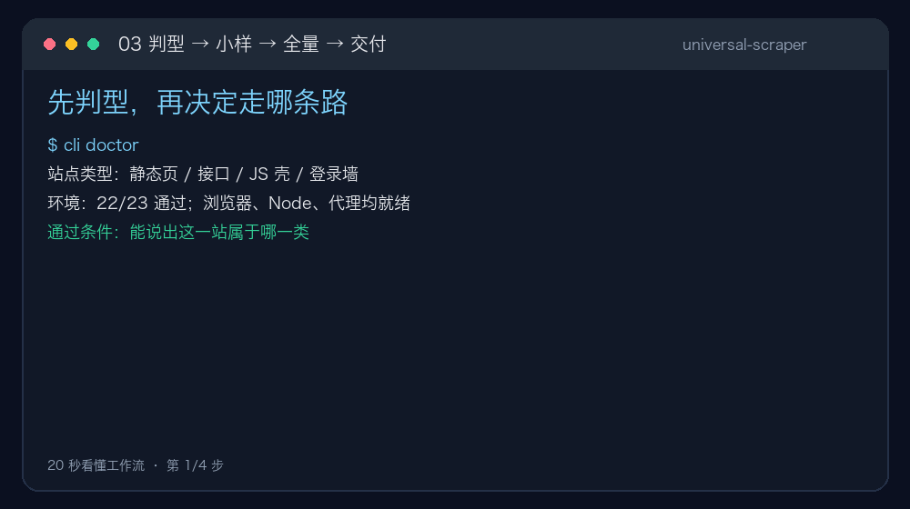
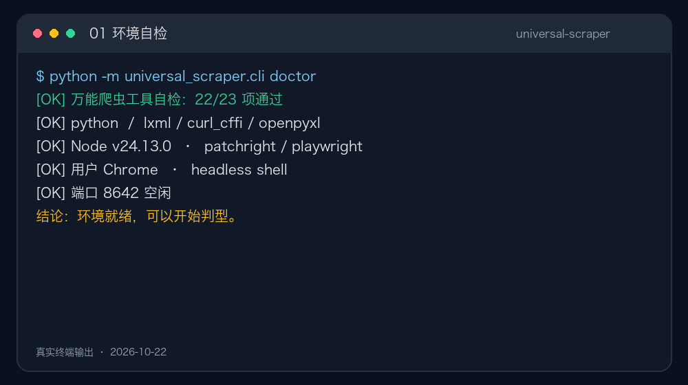
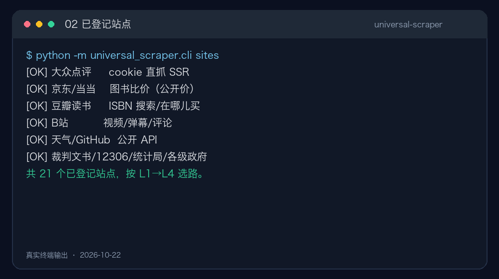

# universal-scraper

**把“从这个网站拿数据”变成一句人话。**

配置驱动 · 四级反爬降级 · 数据校验 · **86 个 Python 模块** · **21 个站点配方** · **738 项测试** · MIT

## 30 秒验证它能跑

~~~bash
git clone https://github.com/qqkkrr/universal-scraper.git
cd universal-scraper
pip install -r requirements.txt
bash scripts/setup.sh          # 装依赖 + 环境体检

python -m universal_scraper.cli doctor
python -m universal_scraper.cli fetch "https://example.com"
~~~

看到 doctor 的“22/23 项通过”和 fetch 的 200 响应，就说明引擎跑通了。

中文文档：[安装与使用说明](docs/zh/安装与使用说明.md) · [使用说明书](docs/zh/使用说明书.md) · [使用者解决方案手册](docs/zh/使用者解决方案手册.md)

## 它解决什么问题

需要的数据散在不同网站上：有的页面直接给，有的藏在接口里，有的要登录才看得到。人工复制粘贴慢，而且同一站点换一天再采，字段和口径可能就变了，结果不可复现。

现成的采集工具大多假设站点结构稳定、没有防护。真实情况恰好相反：同一个任务里，A 站一次就能拿到，B 站要过三道关。所以真正难的不是“发请求”，而是**判断这一站属于哪一类，再选一条成本最低、又不越界的路线**。

## 怎么工作

把“抓数据”拆成五步，每步有明确的通过条件，前一步不过就不进下一步。

| 步骤 | 做什么 | 通过条件 |
|---|---|---|
| 01 判型 | 轻量请求一次目标页，判断是静态页、JS 壳，还是数据在接口里 | 能说出这站属于哪一类 |
| 02 选路线 | 按反爬强度选层级，能走低层不走高层 | 取数成本最低 |
| 03 抓小样 | 先抓 5–10 条，字段摆出来给人看 | 字段对得上再全量 |
| 04 全量 | 限速、断点续跑、异常隔离 | 不中断、不重复 |
| 05 复核 | 字段完整率、唯一键、同页双抓比对 | 完整率 ≥ 90% |

## 反爬的四级降级链

不预设“这站一定很强”，逐级试探，遇到拦截才升级。多数站点停在 L1，真正需要打开浏览器的不到两成。

| 层级 | 手段 | 适用 |
|---|---|---|
| L1 | HTTP 直连，带浏览器指纹与必要请求头 | 静态页、公开接口 |
| L2 | 浏览器指纹模拟，绕开简单环境检测 | 轻中度防护 |
| L3 | 无头浏览器渲染，等数据加载后取 DOM 或接口响应 | JS 渲染的壳页 |
| L4 | 复用使用者本人已登录的浏览器会话 | 登录后才可见的内容 |

L4 只做“复用登录态”：由使用者本人完成登录，工具不代填密码、不代过验证码。

## 验证到什么程度

判断标准只有一条：换一个站点，这套流程还成立吗。

| 类型 | 代表 | 难点 |
|---|---|---|
| 司法公开 | 中国裁判文书网 | 登录墙 + 强风控 |
| 政务服务 | 12306 | 会话校验 |
| 统计口径 | 国家统计局 | 多维查询、翻页结构 |
| 地方公开 | 各级政府门户 | 页面陈旧、编码混乱 |

仓库内置 21 个站点配方，覆盖公开 API、SSR、JS 壳和需登录调优四类：

~~~bash
python -m universal_scraper.cli sites
~~~

引擎本体经 10 轮审计，当前 pytest 收集 **738 项测试**；77 个测试文件，另有独立 CI 脚本。

### 一个真实例子

采 A 股「算力 / 智算中心 / 东数西算 / 数据中心」相关公告时，标题里带 HTML 高亮标签，直接统计会把「计算机能力」「电力」误判成「算力」。按连续词过滤后剔除 402 条，671 条收敛为 269 条——**如果不做这一步，结论会虚高 150%**。

## 边界

- 只采公开数据。不绕过登录墙获取非公开内容，不逆向签名算法，不破解付费/版权墙。
- 默认单站每秒不超过 1 次请求；大任务开工前先估算总请求数。
- 站点改版会让配置失效。工具能降低维护成本，但消不掉它——所以判型表和校验流程是核心资产，不是附件。
- 数据是否可信、口径是否一致，仍要人来判断。工具负责把可疑处标出来，不替人下结论。

## 目录

| 路径 | 内容 |
|---|---|
| SKILL.md | AI 读取的工作流程（五幕引导 + 铁律） |
| universal_scraper/ | 采集引擎本体（86 个 Python 模块） |
| references/ | 反爬升级手册 / 配置字段 / 站点配方 |
| scripts/ | 环境安装、体检、调试 Chrome 启动器、浏览器桥 |
| challenges/ | 挑战用例 |
| webui/ | 本地可视化界面（cli webui） |
| docs/zh/ | 中文使用手册、安装说明、审查记录 |
| docs/assets/ | README 图片与 GIF |

## CLI 速览

fetch（侦察）· run（按配置/任务采集，支持断点续跑）· verify（结果复核）·
snapshot（页面快照离线解析）· batch（批量队列）· pdf（PDF 下载与表格）·
compliance（开工前合规预检）· budget（限速与封锁台账）· research（科研批量采集）

共 49 个 CLI 子命令，查看完整列表：

~~~bash
python -m universal_scraper.cli --help
~~~

## 作为 AI 技能安装

把仓库放进技能目录：

~~~bash
git clone https://github.com/qqkkrr/universal-scraper.git \
  ~/.agents/skills/universal-scraper
bash ~/.agents/skills/universal-scraper/scripts/setup.sh
~~~

之后直接用日常语言让 AI 干活，例如：

- “把这个列表页的商品都抓下来，要名称、价格、链接，存桌面”
- “帮我下载这 10 篇论文的 PDF”
- “这个网站要登录，我扫码登录一次之后你接着抓”
- “盯着这个页面，有更新就告诉我”

## License

MIT
